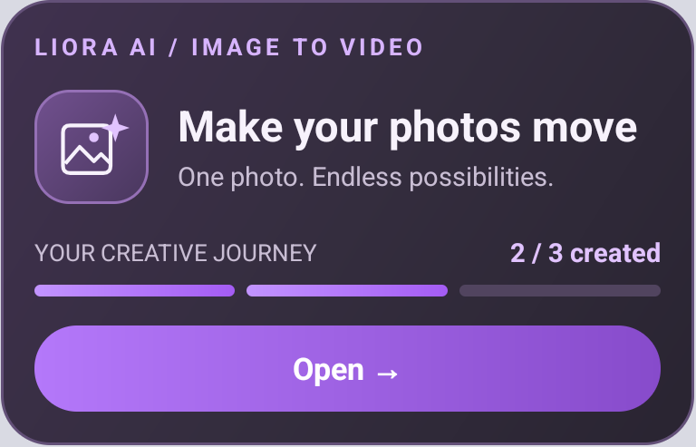

# Android first-video notification

The Android notification uses Liora's plum gradient, Nunito Sans typography,
a photo-and-sparkle illustration, three progress segments,
and an Open action that opens Image to Video directly. It is an ongoing notification in
the notification drawer and, when allowed by system settings, on the lock screen.
It uses compact and expanded native layouts to fit Android's notification limits.
The compact view keeps the illustration, headline, count and Open button within
48dp. The expanded card adds supporting copy, a full-width progress indicator
and a gradient Open button. All artwork uses native vector and shape resources.



## Behavior

- Launching the app, opening Home or resuming restores progress and posts the notification
  if fewer than three unique videos have completed.
- The existing Android notification permission flow is reused. Android has no
  separate runtime permission for lock-screen visibility. No additional reminder
  dialog is shown after the system permission prompt. Lock-screen visibility
  follows the user's system notification settings.
- Channel `liora_video_onboarding_v2` uses normal (`IMPORTANCE_DEFAULT`) priority,
  with public lock-screen content. The former silent v1 channel is migrated and
  removed; an explicitly blocked v1 channel stays blocked. Subsequent changes to
  v2 in system settings are preserved. Normal priority may play the system's
  notification sound when first posted; updates use `setOnlyAlertOnce(true)`.
- No foreground service is introduced.
- Open works with a running app and a cold launch. Cold launches wait for Splash
  authentication, then open the form with Home underneath it for Back navigation.
- Only successful, completed videos count. Failed, cancelled and pending requests
  do not count. Image, text, theme and extended videos share the same counter.
- The native plugin stores `completed_count` and up to three
  `completed_request_ids` in Android SharedPreferences `liora_video_onboarding`.
  The counter survives process termination and is never reduced by deleting a
  video from history. Clearing app data or uninstalling can reset local storage.
- Completion events from polling, foreground FCM, notification opening and
  background FCM all use the same native plugin. Duplicate request IDs cannot
  advance progress twice. A shared lock serializes foreground/background writes.
- History is reconciled on opening/resuming to include existing videos and
  completions missed while the app was closed. Once three are saved, subsequent
  launches skip history reconciliation and keep the notification cancelled.
- Android owns the posted notification, so normally closing the app or removing
  it from Recents does not cancel it. No Dart process needs to keep running.

Android permits users to dismiss ongoing notifications on some versions, disable
the notification channel, hide lock-screen notifications, or force-stop an app.
This feature respects those controls. A dismissed notification is restored on the
next app visit while progress is below three. It is not scheduled to restart after
a reboot. Background progress updates require FCM delivery; missed updates are
reconciled from history on the next visit.

## Code

- `packages/video_onboarding_activity`: app-local Android Flutter plugin. Automatic
  registration also makes it available in Firebase Messaging's background engine.
- `lib/core/notifications/video_onboarding_service.dart`: history reconciliation.
- `lib/core/events/video_generation_events.dart`: completion events from UI flows.
- `lib/core/firebase/firebase_service.dart`: push completion and permission hooks.

## Checks

```sh
flutter test test/video_onboarding_activity_test.dart \
  test/video_notification_navigation_test.dart test/creating_video_polling_test.dart
cd android
./gradlew :video_onboarding_activity:testDebugUnitTest :app:assembleDebug
```

On a device, grant notifications, open Home and check the drawer and lock screen.
Verify 0/3, 1/3 and 2/3 after unique completions, then verify cancellation after
the third. Close/reopen the app between completions and replay a completed
request to verify persistence and deduplication. Check Open from both collapsed
and expanded layouts. Deny notifications to verify generation still works.
